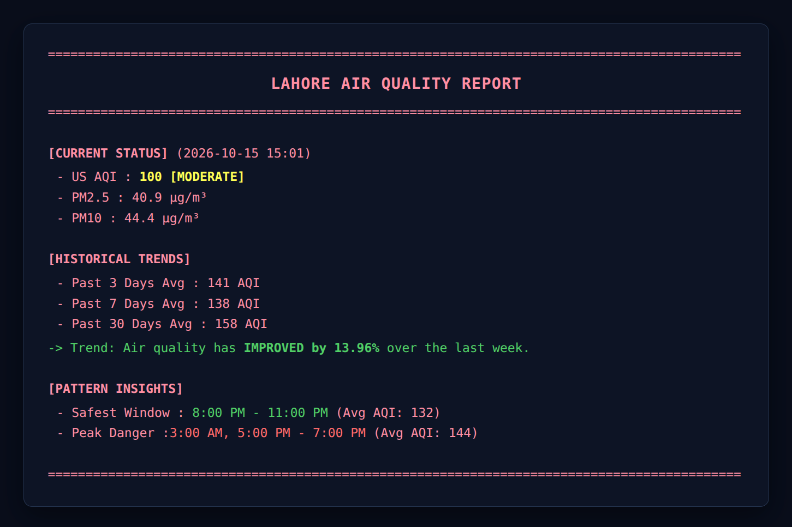

# 🌍 Lahore Air Quality Trend Analyzer

<p align="center">
  
  
  
  
</p>

A robust command-line application that fetches, caches, processes, and analyzes historical and real-time air quality metrics for **Lahore, Pakistan**. Built using Python, Pandas, and the Open-Meteo API, this tool delivers clean terminal reports highlighting current status, multi-day historical trends, and daily pollution pattern insights.

---

## 📸 Output Preview

<p align="center">
  
</p>

---

## 📂 Project Architecture

This project follows a modular architecture separating data fetching, core analytics, data persistence, and automated testing:

```Markdown
Air Trend Analyzer/
├── assets/
│   └── OUTPUT.png              # Terminal output screenshot for documentation
├── data/
│   ├── processed/
│   │   └── lahore_aqi_clean.csv # Cleaned, analysis-ready dataset
│   └── raw/
│       └── lahore_aqi_raw.json  # Raw API response cache
├── src/
│   ├── analyze_data.py          # Statistical analysis & pattern matching engine
│   └── fetch_data.py            # API client with automated local caching
├── tests/
│   ├── __init__.py
│   ├── conftest.py              # Pytest fixtures & mock datasets
│   ├── test_analyze_data.py     # Unit tests for analytics & AQI thresholds
│   └── test_main.py             # Unit tests for time-window grouping & formatters
├── .gitignore
├── main.py                      # Main entry point & CLI report renderer
├── README.md
├── requirements.txt             # Production dependencies
└── requirements-dev.txt         # Development & testing dependencies
```

---

## ✨ Key Features

- **Real-Time & Historical Data:** Automatically queries hourly `PM2.5`, `PM10`, and `US AQI` metrics.
- **Smart Offline Fallback:** Gracefully detects network failures and switches to local JSON cache to ensure continuous execution.
- **Trend Comparison:** Calculates percentage improvements or degradations in air quality compared to previous weeks.
- **Pattern Insights:** Analyzes hourly trends over a 7-day rolling window to pinpoint the safest outdoor windows and peak danger hours (including midnight-wrap handling).
- **Comprehensive Test Suite:** Fully tested using `pytest` with parameterized unit tests and custom fixtures.

---

## 🚀 Getting Started

### 1. Clone the Repository

```Shell
git clone https://github.com/abdullahh-devs/air-trend-analyzer.git
cd air-trend-analyzer
```

### 2. Set Up a Virtual Environment

```Shell
python -m venv venv

# On Windows:
venv\Scripts\activate

# On macOS/Linux:
source venv/bin/activate
```

### 3. Install Dependencies

**Install production dependencies:**

```
pip install -r requirements.txt
```

If you plan to run tests or contribute, install **development dependencies**:

```
pip install -r requirements-dev.txt
```

## 💻 Usage

Run the main script to fetch fresh data, process it, and print the report:

```
python main.py
```

If you are offline or want to skip network requests and analyze the latest cached data, use the `--offline` flag:

```
python main.py --offline
```

## 🧪 Running Tests

This project uses `pytest` for unit testing. To run the test suite and check data boundaries, time wrappers, and analytical algorithms, execute:

```
pytest -v
```

## 🛠️ Tech Stack

- **Language:** Python 3.10+
- **Data Manipulation:** Pandas
- **API Requests:** Requests & Open-Meteo Air Quality API
- **Testing:** Pytest

## 👤 Author

**Abdullah Jehangir**

- GitHub: [@abdullahh-devs](https://github.com/abdullahh-devs)
